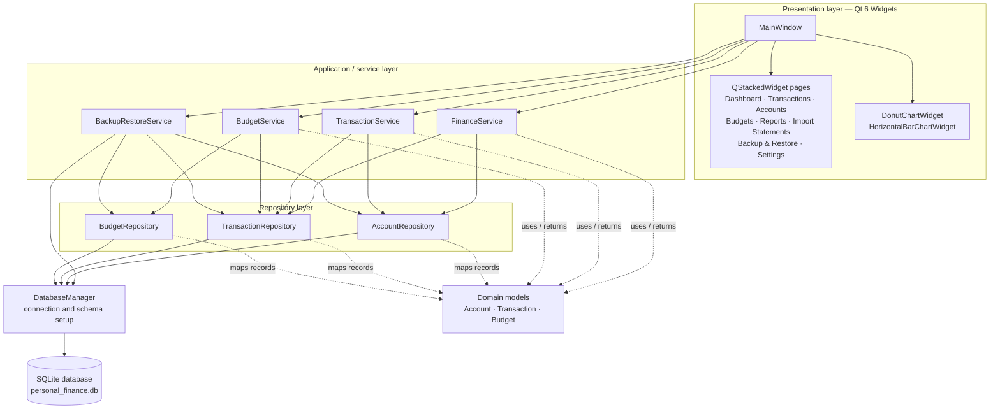
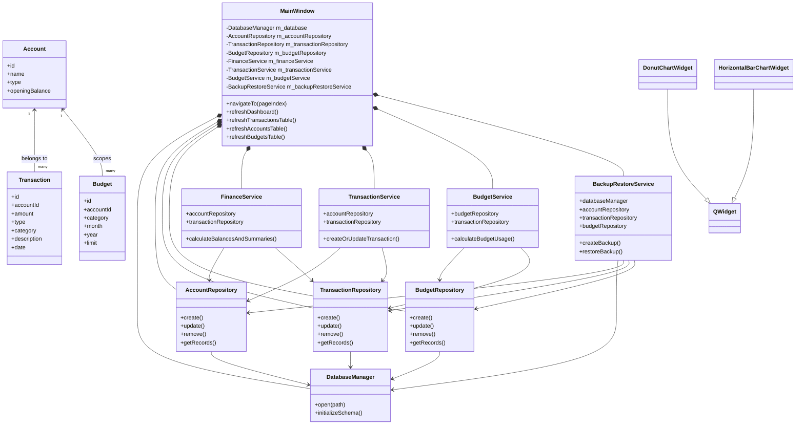
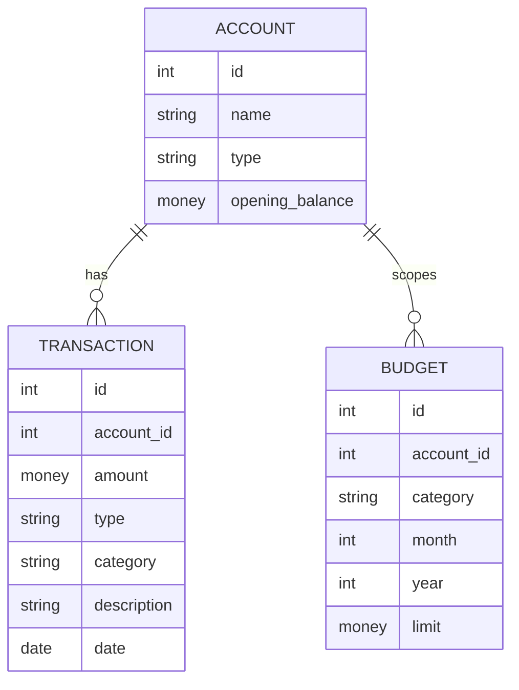
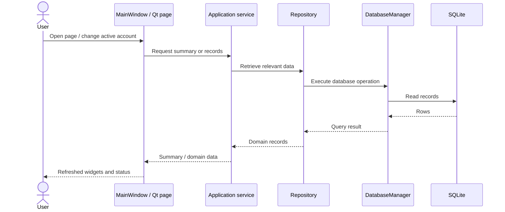
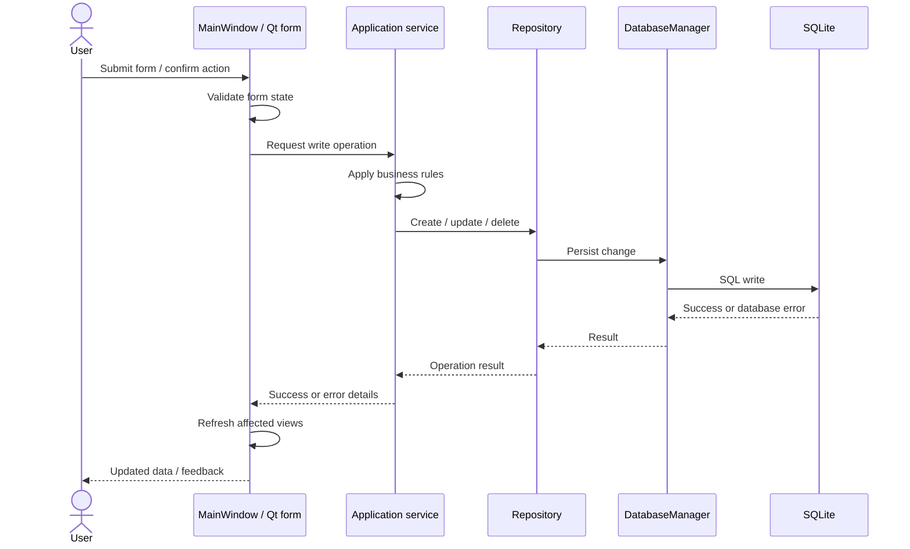
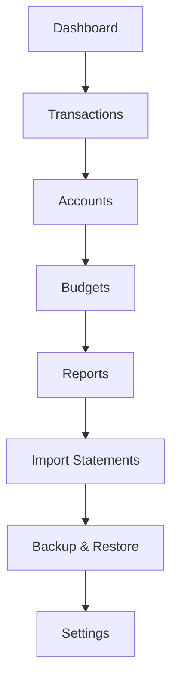
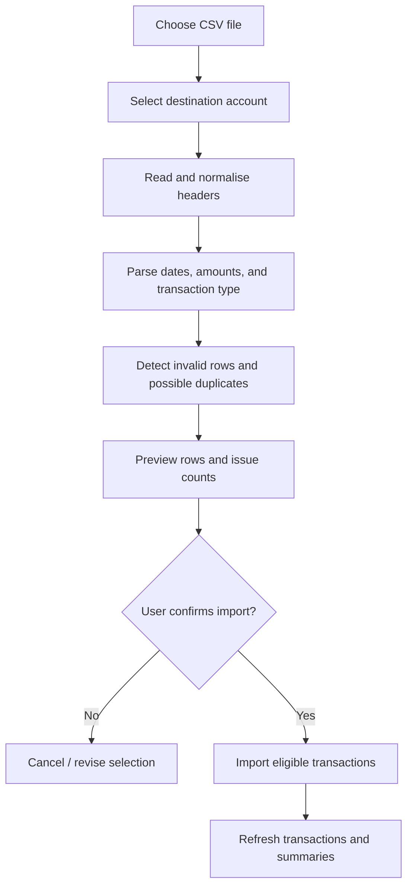

# Personal Finance & Budget Management System — Architecture

> **Project:** Personal Finance & Budget Management System (PFBM)  
> **Implementation:** C++17, Qt 6 Widgets, SQLite, and CMake  
> **Repository:** [StackHub123/Personal-Finance-Budget-Manager](https://github.com/StackHub123/Personal-Finance-Budget-Manager)

This document describes the architecture represented in the mini-project report. It focuses on the separation between the Qt presentation layer, application services, repositories, database management, and domain models.

## 1. Architectural goals

PFBM is a local desktop application for recording income and expenses, organising records by account, setting category-based budgets, and reviewing financial summaries. Its architecture is intended to:

- keep widget code separate from business rules and SQL statements;
- represent accounts, transactions, and budgets as domain concepts;
- centralise database connection and schema initialisation;
- provide service-level operations that coordinate repositories;
- keep financial data in a local SQLite database; and
- provide CSV statement-import and JSON backup/restore workflows.

## 2. High-level architecture

The application follows a layered architecture. The main window handles user interaction and page navigation. Application services coordinate business operations. Repositories encapsulate persistence operations. `DatabaseManager` owns database lifecycle and schema setup. Domain models represent the main financial entities.



### Layer responsibilities

| Layer / component | Responsibility |
|---|---|
| Presentation | Displays pages, collects input, handles navigation, validates basic form state, and shows status or error feedback. |
| `MainWindow` | Coordinates the main Qt window, page navigation, active-account context, widget refresh, and collaboration between services. |
| Service layer | Implements application-level operations using one or more repositories. |
| Repository layer | Encapsulates entity-specific database operations, SQL details, parameter binding, and row-to-model conversion. |
| `DatabaseManager` | Opens the local database connection and initialises the schema. |
| Domain models | Represent account, transaction, and budget data independently of the widgets. |

## 3. Main classes and dependencies

The following Mermaid class diagram summarises the principal classes and dependencies described in the report. It is a conceptual view; it is not a replacement for checking the declarations in the current source tree.



The service dependencies shown above follow the constructor composition described in the report:

- `FinanceService` uses `AccountRepository` and `TransactionRepository`.
- `TransactionService` uses `AccountRepository` and `TransactionRepository`.
- `BudgetService` uses `BudgetRepository` and `TransactionRepository`.
- `BackupRestoreService` is constructed with `DatabaseManager` and all three repositories.
- Each repository uses `DatabaseManager` for database access.

The chart widgets specialise `QWidget` and override `paintEvent()` to draw their visualisations. The design relies primarily on composition and focused class responsibilities rather than a large inheritance hierarchy.

## 4. Domain model and data relationships

### Account

An account represents a place where money is held or a financial liability is recorded, such as a cash wallet, current account, or credit card. It has an identifier, name, account type, and opening balance.

### Transaction

A transaction stores an amount, type, category, description, date, and account association. The report describes the amount as a positive magnitude; the transaction type identifies whether the record is income or expense.

### Budget

A budget defines a category spending limit for a month and year and may be associated with an account. Budget usage is calculated by comparing the limit with eligible expenses for the same account, category, and period.



**Category representation:** The report describes category as a value on transaction and budget records. A dedicated Category table/model is listed as a possible future enhancement, not as a current architectural component.

**Money representation:** The report notes that backup/restore validation uses paise-based integer fields for financial values. Display formatting is handled separately from stored values.

## 5. Runtime data flows

### Read flow

1. The user opens a page or changes the active account.
2. `MainWindow` calls the relevant refresh operation.
3. A service and/or repository retrieves the required records from SQLite.
4. Domain data is converted into display-friendly values.
5. Qt widgets are updated and the status area communicates readiness.



### Write flow

1. The user submits a form or confirms an action.
2. Input is validated at the UI/service boundary.
3. A service invokes the appropriate repository operation.
4. The repository persists the change through `DatabaseManager`.
5. The UI refreshes the affected table and dependent summaries.
6. Errors are surfaced through explanatory feedback.



## 6. Frontend navigation

The Qt interface is built with Qt Widgets. A root layout places a navigation sidebar beside the main content area. A `QStackedWidget` hosts the principal application pages, and a shared header displays the page title and active-account selector.



This diagram represents the navigation sequence illustrated in the report. In the application, the user can select pages from the sidebar rather than being forced to follow a linear wizard.

### Page responsibilities

| Page | Main responsibility |
|---|---|
| Dashboard | Shows selected-account financial summary, recent activity, and budget usage. |
| Transactions | Adds, edits, deletes, searches, and filters income and expense records. |
| Accounts | Creates, edits, displays, and removes financial accounts. |
| Budgets | Manages monthly category limits and displays spent, remaining, and status values. |
| Reports | Displays period-based summaries, category proportions, comparison charts, and a detail table. |
| Import Statements | Previews CSV statement rows, parsing issues, and possible duplicates before confirmation. |
| Backup & Restore | Exports local records to JSON and validates a selected backup before replacement. |
| Settings | Persists preferences such as theme, date format, number grouping, report period, and duplicate policy. |

## 7. Persistence and configuration

### SQLite database

The report describes a local SQLite database named `personal_finance.db`. The application obtains a writable application-data directory through `QStandardPaths::AppDataLocation`, creates the directory when needed, opens the database, and initialises its schema.

```cpp
const QString dataDirectory =
    QStandardPaths::writableLocation(QStandardPaths::AppDataLocation);

const QString databasePath =
    QDir(dataDirectory).filePath("personal_finance.db");
```

The database is embedded/local; the report does not describe a separate database server or a hosted synchronisation service.

### Settings

`QSettings` stores user-interface and workflow preferences. The report identifies settings for the active account, theme, date display format, number format, default report period, and import duplicate policy.

### JSON backup and restore

The backup workflow exports accounts, transactions, and budgets to JSON. Restore validates the JSON structure and required fields before asking the user to confirm replacement of the current data. Restore replaces stored records, so the confirmation step is important. Transaction-safe rollback on every failed write is listed in the report's future-work priorities and should not be assumed unless it is verified in the current code.

## 8. CSV statement import

The import workflow follows a **review-before-commit** pattern:



The report describes support for common headers and delimiters, date parsing, amount parsing (including common currency symbols and grouping separators), type inference where supported, and duplicate checks. Compatibility with every bank-specific CSV format is not guaranteed. PDF or Excel statements generally need to be exported to CSV first.

## 9. Reports and chart widgets

The Reports page provides report-type and period controls, graphical summaries, and a detail table.

- `DonutChartWidget` draws category proportions. It displays an empty-state message when the total is zero.
- `HorizontalBarChartWidget` draws scaled horizontal comparisons, labels, and formatted values, with an empty state when data is unavailable.
- Both chart widgets use Qt painting and request repainting when their values or theme settings change.

## 10. Error handling and validation

The report describes validation and feedback at multiple boundaries:

- reject missing or invalid required input;
- validate transaction dates, amounts, transaction types, and account references;
- validate budget month/year and non-negative limits;
- propagate database and repository errors to the UI;
- validate JSON structure and required fields before restore;
- ask for confirmation before deleting records or replacing stored data; and
- refresh dependent views after successful writes.

## 11. Important limitations and verification notes

This document is based on the supplied mini-project report, not a fresh source-code audit. Before treating it as an exact implementation specification, check the current repository and final demonstration build.

The report itself cautions that screenshots demonstrate interface construction but do not prove every scenario has been exhaustively tested. Its testing matrix is a plan with Pass/Fail fields to be completed against the final build. Do not describe all cases as passed unless they have actually been executed.

The report also lists the following as future enhancements: transaction-safe restore rollback, richer CSV mapping and duplicate fingerprints, a dedicated category model, report export, date-range search, optional encrypted backups, and automated release packaging.
